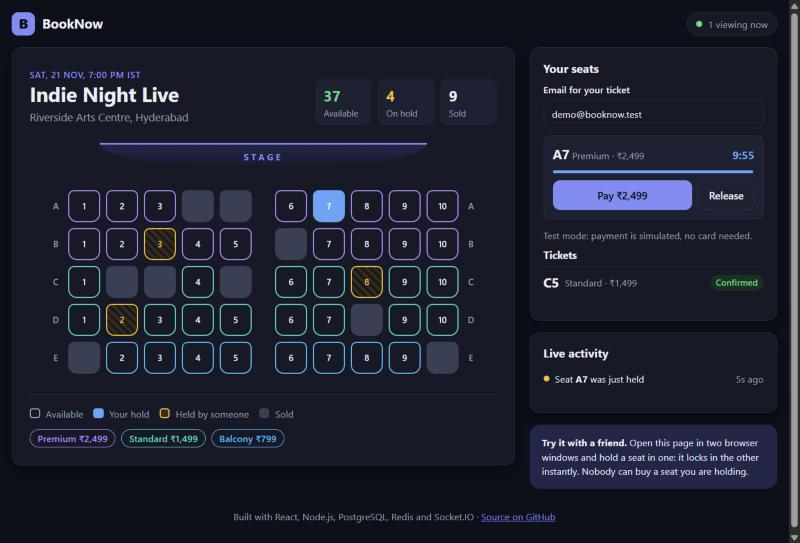
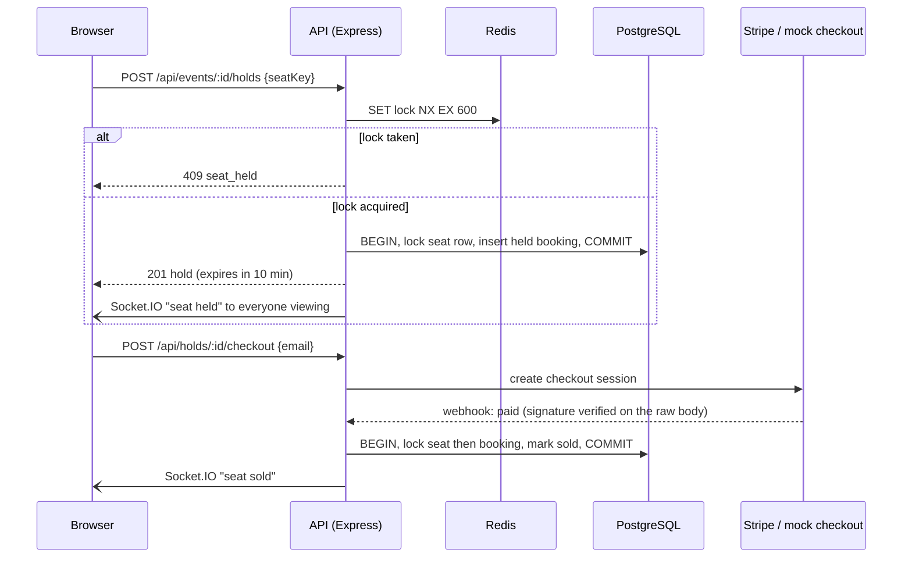
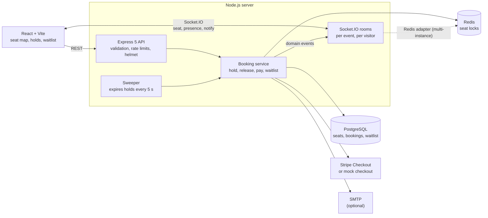

# BookNow

Live event seat booking where two people can never buy the same seat. Seats are held with Redis locks, sold inside PostgreSQL transactions, and every change is pushed to every open browser over Socket.IO.

**[Live demo](LIVE_URL)** · [](https://github.com/pardhu0201/BookNow/actions/workflows/ci.yml)



> Open the demo in two browser windows and hold a seat in one: it locks in the other instantly. The free server sleeps when idle, so the first load can take about a minute.

## What it does

- **Hold a seat** for 10 minutes. Everyone else sees it lock in real time and cannot take it while you pay.
- **Pay** through Stripe Checkout (test mode), or a built-in test checkout when no Stripe keys are configured, so the demo works with no payment account.
- **Release** a seat, or let the hold run out: it goes **first to the waitlist** (held 5 minutes for the next person, who is notified in the app and by email), and only then back on the map.
- Up to 4 holds per visitor, a live viewer count and an activity feed.

## How double-booking is prevented

Each layer catches what the one before it can miss:

| Layer | Mechanism | What it guarantees |
| --- | --- | --- |
| Fast path | Redis `SET lock owner NX EX 600`; release by a Lua compare-and-delete script | Contention is rejected in one Redis round trip; nobody can release someone else's hold |
| Source of truth | `SELECT … FOR UPDATE` on the seat row, plus partial unique indexes: one `held` and one `confirmed` booking per seat | Even if Redis loses a lock (restart, eviction), PostgreSQL refuses a second hold or sale |
| Payments | Confirmation is idempotent; a late payment is accepted only if nobody else holds the seat, otherwise refunded | Stripe webhook retries and double clicks sell once; an expired hold never causes a double sale |
| Lock order | Every transaction locks the seat row before booking rows | Holds and late payments on the same seat cannot deadlock |
| Fairness | A freed seat is offered to the waitlist (`FOR UPDATE SKIP LOCKED`) before anyone is told it is free | The person who waited gets it, not whoever refreshes fastest |



## Verified

| Check | Result |
| --- | --- |
| Automated tests against real PostgreSQL and Redis | 35 passing in CI |
| 100 visitors hold the same seat at the same instant | exactly 1 succeeds, 99 get 409 |
| 120 concurrent buyers simulate a rush (hold, pay, release, let holds lapse) | 0 seats sold twice; sold seats = confirmed bookings |
| k6 load test: 120 virtual users on 50 seats ([CI run](https://github.com/pardhu0201/BookNow/actions/runs/39770788969)) | 821 requests, 0 errors; hold latency 19 ms median, 112 ms p95; hall sold out (50/50) with 0 seats sold twice and 542 contested holds correctly refused |
| Stripe webhook replayed 3 times at once | 1 sale |

## Bugs fixed from the first version

| Bug | Impact | Fix |
| --- | --- | --- |
| JSON body parser registered before the Stripe webhook route | Signature check always failed: no payment could ever confirm a booking | Raw-body route registered first |
| Payment confirmation did not check who held the seat | After a hold expired, two people could pay for and be sold the same seat | Late payments sell only if the seat is free, otherwise refund; unique index on confirmed bookings |
| `sendMail` promise had no error handling | Any mail failure crashed the whole server | Mailer never rejects; failures are logged |
| Waitlist hold was taken under a random id | The seat was blocked for 5 minutes and the waitlisted person could not use it | Hold is created in the waitlisted visitor's own session |
| Release endpoint ignored whether the caller owned the lock | Anyone could announce a held seat as free and trigger the waitlist | Ownership checked; same 404 for "missing" and "not yours" |
| Price column not selected when creating a booking | Every booking was charged ₹10 | Price read from the seat row |
| Attendee CSV export had no authentication | Every customer email was public | Admin token, plus CSV formula-injection escaping |
| Client called `/api/events/:id/seatmap`, which did not exist; no Dockerfiles or client app | The app could not run | Full API, React client, Docker image |
| User id came from the request body | Anyone could act as anyone else | Server-issued, HMAC-signed guest sessions |

## Architecture



## API

| Method | Path | Purpose |
| --- | --- | --- |
| `POST` | `/api/session` | Issue a guest session token |
| `GET` | `/api/events` | List events with seats left |
| `GET` | `/api/events/:eventId` | Seat map, your holds, your tickets, waitlist position |
| `POST` | `/api/events/:eventId/holds` | Hold a seat `{ seatKey }` |
| `DELETE` | `/api/holds/:bookingId` | Release your hold |
| `POST` | `/api/holds/:bookingId/checkout` | Start payment `{ email }`, returns a checkout URL |
| `GET` | `/api/bookings/:bookingId` | Booking status (owner only) |
| `POST` / `DELETE` | `/api/events/:eventId/waitlist` | Join (`{ email }`) or leave the waitlist |
| `POST` | `/api/webhooks/stripe` | Stripe webhook (signature verified) |
| `POST` | `/api/payments/mock/:bookingId` | Complete a test payment (mock mode only) |
| `GET` | `/api/admin/events/:eventId/attendees.csv` | Attendee export (`x-admin-token`) |
| `GET` | `/api/admin/events/:eventId/integrity` | Audit: seats sold twice, sold without booking (`x-admin-token`) |
| `GET` | `/api/health` | Database and Redis health |

Errors are JSON: `{ "error": { "code": "seat_held", "message": "…" } }`.

## Run it locally

With Docker:

```bash
docker compose up --build
```

The app is on <http://localhost:4000>, and emails it sends show up in Mailpit at <http://localhost:8025>.

For development with hot reload, run the databases in Docker and the app on your machine:

```bash
docker compose up -d postgres redis
cd server && npm install && npm run dev
cd client && npm install && npm run dev
```

The client is then on <http://localhost:5173> and proxies the API.

Tests run against real PostgreSQL and Redis (`booknow_test` and Redis database 1, so dev data is untouched):

```bash
cd server && npm test
```

Load test with [k6](https://k6.io) (start the server with `RATE_LIMIT=off`, since every virtual user shares one IP):

```bash
k6 run loadtest/rush.js
```

## Deploy for free

[](https://render.com/deploy?repo=https://github.com/pardhu0201/BookNow)

`render.yaml` creates one free Docker web service. With no `DATABASE_URL` or `REDIS_URL`, the container starts its own PostgreSQL and Redis (`docker/entrypoint.sh`), so it needs no other accounts. Data resets on each restart, which suits a public demo; in demo mode the hall also refills a few minutes after it sells out.

For durable data, set `DATABASE_URL` (for example a free [Neon](https://neon.tech) database) and `REDIS_URL` (for example [Upstash](https://upstash.com)) in the Render dashboard. No code changes.

## Configuration

| Variable | Default | Meaning |
| --- | --- | --- |
| `DATABASE_URL` | local Postgres | PostgreSQL connection string |
| `REDIS_URL` | `redis://localhost:6379` | Redis connection string (`rediss://` for TLS) |
| `SESSION_SECRET` | dev value | Signs guest session tokens; required in production |
| `APP_URL` | `RENDER_EXTERNAL_URL` or localhost | Public URL used in checkout redirects and emails |
| `STRIPE_SECRET_KEY`, `STRIPE_WEBHOOK_SECRET` | unset | Set both (test mode) to use Stripe Checkout instead of the mock |
| `ADMIN_TOKEN` | unset | Enables the admin endpoints |
| `SMTP_HOST`, `SMTP_PORT`, `SMTP_USER`, `SMTP_PASS`, `MAIL_FROM` | unset | Email delivery; without it, emails are logged and skipped |
| `HOLD_SECONDS` / `WAITLIST_HOLD_SECONDS` | `600` / `300` | Hold lengths |
| `MAX_HOLDS_PER_SESSION` | `4` | Seats one visitor can hold at once |
| `DEMO_MODE` | `false` | Refill the demo hall a few minutes after it sells out |
| `RATE_LIMIT` | on | Set `off` for load testing |

## Project layout

```
server/
  src/
    app.js              routes, auth, validation, error handling
    services/bookings.js  holds, release, payments, waitlist, expiry
    services/locks.js   Redis seat locks (SET NX EX + Lua release)
    services/payments.js  Stripe Checkout or mock checkout
    realtime.js         Socket.IO rooms and Redis adapter
    migrations/         SQL schema with the uniqueness guarantees
  test/                 35 tests on real PostgreSQL and Redis
client/src/             React app (seat map, holds, waitlist, checkout)
loadtest/rush.js        k6 rush with an integrity audit
docker/entrypoint.sh    all-in-one mode for free hosting
```
